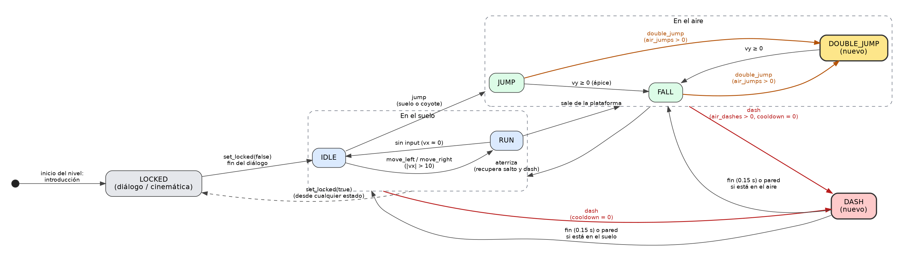
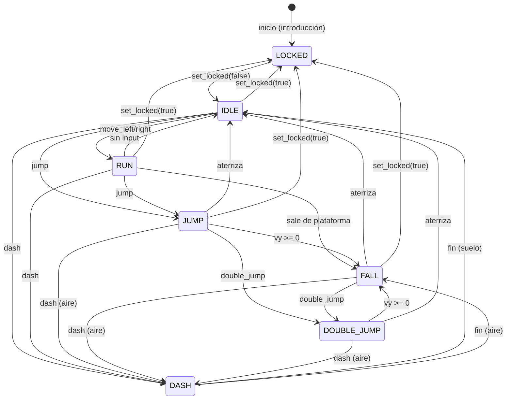

# Mask Dude – Movimientos adicionales y narrativa

## 1. Movimientos adicionales (además de caminar y el salto básico)

Se implementaron **dos**: **doble salto** y **dash**. Código: `scripts/player/MaskDude.gd`.

### 1.1 Acciones en el Input Map (`Project > Project Settings > Input Map`)

| Acción | Teclas | Qué hace |
|---|---|---|
| `move_left` / `move_right` | A / D, ← / → | Caminar |
| `jump` | Espacio, W, ↑ | Salto básico (suelo o margen "coyote") |
| **`double_jump`** | Espacio, W, ↑ | **Doble salto**: segundo impulso en el aire |
| **`dash`** | Shift, K | **Dash**: impulso horizontal rápido |
| `interact` | Enter, E | Avanzar diálogos y cinemáticas |
| `restart` / `mute` / `debug_state` | R / M / F3 | Reiniciar / silenciar / mostrar el estado sobre el jugador |

`double_jump` comparte teclas con `jump` a propósito, pero es una acción aparte: se puede reasignar a otra tecla sin tocar el código.

### 1.2 Parámetros (variables `@export`, editables en el Inspector del nodo `MaskDude`)

| Grupo | Parámetro | Valor | Descripción |
|---|---|---|---|
| Movimiento | `max_speed` | 140 px/s | Velocidad máxima al caminar |
| | `acceleration` / `friction` | 1100 / 1400 | Aceleración y frenado |
| | `air_control` | 0.8 | Control horizontal en el aire |
| Salto | `jump_velocity` | −330 | Impulso del salto básico |
| | `gravity` / `fall_gravity_multiplier` | 950 / 1.4 | Gravedad y caída más rápida |
| | `jump_cut_multiplier` | 0.45 | Soltar el botón recorta el salto |
| | `coyote_time` / `jump_buffer_time` | 0.1 s / 0.1 s | Márgenes de tolerancia |
| **Doble salto** | `max_air_jumps` | 1 | Saltos extra en el aire (se recuperan al tocar suelo) |
| | `double_jump_velocity` | −300 | Impulso del segundo salto |
| | `ground_near_distance` | 8 px | Cerca del suelo, la pulsación se trata como salto normal en cola |
| **Dash** | `dash_speed` | 320 px/s | Velocidad durante el dash |
| | `dash_duration` | 0.15 s | Duración (recorre ≈ 48 px = 3 tiles) |
| | `dash_cooldown` | 0.35 s | Espera antes de poder repetirlo |
| | `max_air_dashes` | 1 | Dashes en el aire (se recuperan al tocar suelo) |
| | `ghost_interval` | 0.035 s | Separación de las imágenes residuales (efecto visual) |

Reglas: durante el dash no hay gravedad; el dash en el suelo no gasta la carga aérea; al terminar conserva `max_speed` de inercia; si choca con una pared, termina antes.

### 1.3 Diagrama de estados del jugador

Estados (`enum State`): `IDLE`, `RUN`, `JUMP`, `FALL`, **`DOUBLE_JUMP`**, **`DASH`**, `LOCKED`.

| De | A | Condición |
|---|---|---|
| IDLE | RUN | `move_left` / `move_right` con \|vx\| > 10 |
| RUN | IDLE | sin input, vx ≈ 0 |
| IDLE / RUN | JUMP | `jump` en el suelo o dentro del margen coyote |
| RUN / IDLE | FALL | sale de una plataforma sin saltar |
| JUMP | FALL | vy ≥ 0 (ápice) |
| JUMP / FALL | **DOUBLE_JUMP** | `double_jump` en el aire, `air_jumps` > 0 y suelo no cercano |
| DOUBLE_JUMP | FALL | vy ≥ 0 |
| JUMP / FALL / DOUBLE_JUMP | IDLE / RUN | aterriza (recupera salto extra y dash aéreo) |
| cualquiera menos LOCKED | **DASH** | `dash`, cooldown = 0 y (en suelo, o en aire con cargas) |
| DASH | IDLE / RUN | termina la duración o choca con pared, en el suelo |
| DASH | FALL | termina la duración o choca con pared, en el aire |
| cualquiera | LOCKED | `set_locked(true)` (diálogo o cinemática) |
| LOCKED | IDLE | `set_locked(false)` |

Para verlo en el juego: pulsa **F3** y aparecerá el nombre del estado sobre Mask Dude.

---

## 2. Narrativa dentro del juego

Textos en `scripts/narrative/Story.gd`; escenas en `scripts/world/World.gd`; caja de diálogo en `scenes/narrative/DialogueBox.tscn`.

**Conflicto:** en la noche de la cosecha las frutas de la ofrenda despertaron y escaparon flotando a la Cámara Antigua; el Tótem Dorado se apagó. Si la ofrenda no llega antes del amanecer, se pierde la cosecha del año siguiente. Mask Dude, guardián de la aldea, debe recuperarlas y llegar al Tótem.

### 2.1 Inicio del nivel (plantea el conflicto)
Cinemática: pantalla negra con el título **"EL FESTÍN DEL TÓTEM"** y tres tarjetas de texto:
1. "Cada año, en la noche de la cosecha, la aldea ofrece sus mejores frutas al Tótem Dorado."
2. "Esta vez las frutas despertaron. Escaparon flotando hacia la Cámara Antigua... y el Tótem se apagó."
3. "Si la ofrenda no llega antes del amanecer, la cosecha del próximo año se perderá."

Después se revela el nivel con el Tótem apagado (se enciende un poco con un sonido) y hay un diálogo (el jugador está bloqueado):
- **Mask Dude:** "Las frutas flotan por toda la cámara... y el Tótem está arriba, al otro lado."
- **Tótem Dorado:** "Guardián de la Máscara... recoge la ofrenda y tráela hasta mí antes del amanecer."
- **Tótem Dorado:** "Los espíritus te prestan dos poderes: el doble salto y el dash. Úsalos con sabiduría."
- **Mask Dude:** "Entendido. ¡Vamos por esas frutas!"

Texto de objetivo en pantalla: "Objetivo: recoge las frutas y llega al Tótem Dorado".

### 2.2 Durante el nivel
| Zona | Tipo | Texto |
|---|---|---|
| Borde del bloque inicial | Consejo | "Doble salto: pulsa SALTO otra vez en el aire (Espacio / W / ↑)" |
| Sobre la segunda plataforma flotante | Consejo | "Dash: pulsa SHIFT o K para lanzarte hacia delante (una vez por salto)" |
| Tablón derecho (antes del Tótem) | Diálogo | Tótem: "Ya siento tu ofrenda, guardián... sube hasta mi bloque cuando estés listo." / Mask Dude: "Casi llego. ¿Habré recogido todas?" |

### 2.3 Al terminar (cierra el conflicto; depende de las frutas recogidas)
Al tocar el Tótem: suena el jingle de victoria, el Tótem se enciende (más brillante cuanto más completa la ofrenda), diálogo final y pantalla **FIN**.

| Resultado | Diálogo final | Epílogo |
|---|---|---|
| Todas las frutas | "¡Todas las frutas! La ofrenda está completa." / "Lo logramos... la aldea tendrá su cosecha." / "Mi luz vuelve a brillar. Que comience el Festín. Gracias, guardián." | "La cosecha está a salvo. La aldea celebra bajo la luz del Tótem." |
| Algunas | "Me traes N de M frutas... la ofrenda está incompleta." / "Perdón. Algunas flotaban más alto de lo que pensé." / "Mi luz brilla apenas. El Festín será modesto este año. Quizá puedas volver por el resto." | "La cosecha será escasa este año. ¿Podrás recuperar todas las frutas?" |
| Ninguna | "Llegas con las manos vacías, guardián... la ofrenda no está." / "Lo sé... Déjame intentarlo otra vez." / "Mi luz casi se apaga. Las frutas siguen flotando en la cámara. Inténtalo de nuevo." | "La noche sigue oscura. Las frutas aún esperan en la Cámara Antigua." |

Controles de la narrativa: **Enter / E** avanzan el texto (la primera pulsación lo completa); **Esc** salta la introducción o el diálogo en curso.
